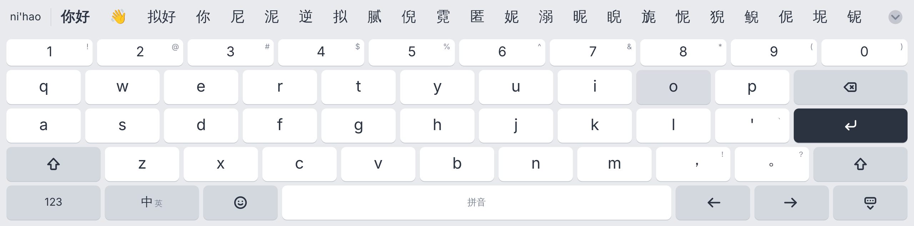
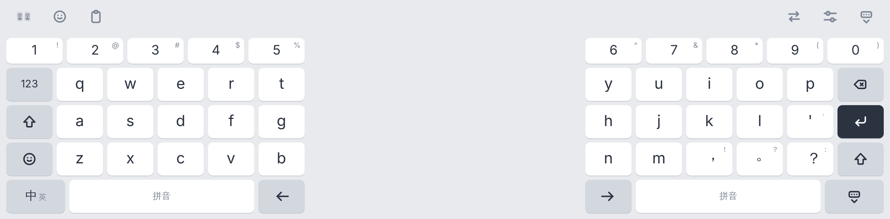
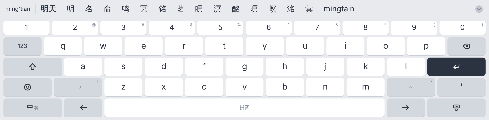
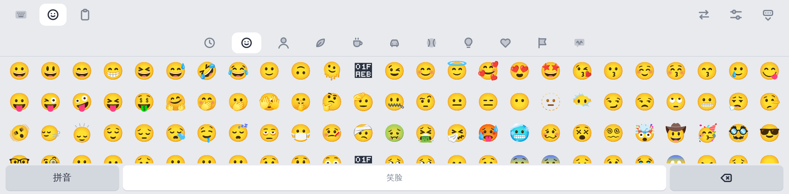
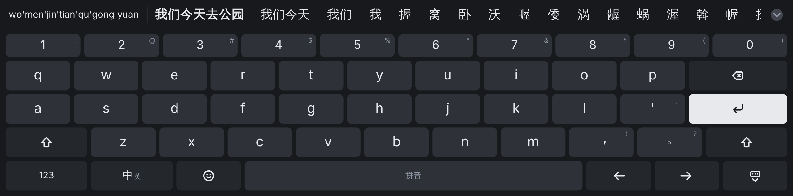
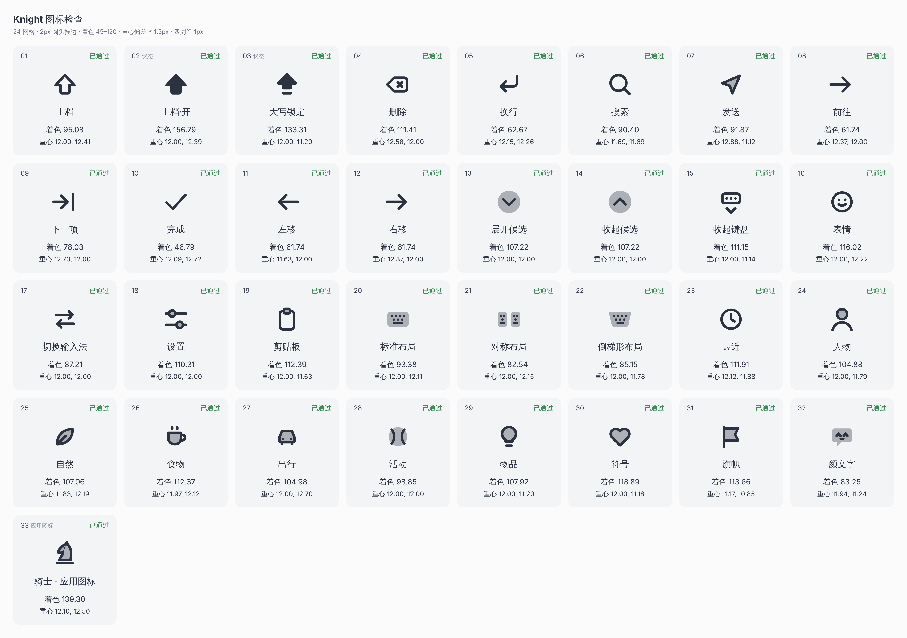

# Knight 输入法

为平板定制的安卓拼音输入法。不联网，不收集数据。



## 功能

**拼音**
- 全拼、简拼（`zg` → 中国）、混拼（`nih` → 你好）、整句（`womenjintianqugongyuan` → 我们今天去公园）
- **自动纠错**：`tain`→天、`nihoa`→你好、`zhogn`→中、`gognzuo`→工作、`sjijian`→时间、`wiaini`→我爱你。
  能认出字母顺序颠倒、按到旁边的键、漏打或多打一个字母；打对的拼音不会被改
- **模糊音**：z/zh、c/ch、s/sh、n/l、f/h、r/l、an/ang、en/eng、in/ing、ian/iang、uan/uang，每对单独开关
- 分段选词、记住常用词和自己组的词、候选里跟着表情（开心 → 😄）、中英混打（打 `hello` 会把英文排前面）

**英文**
- 单词补全和改正，空格时自动纠正（`teh` → the、`dont` → don't），改错了马上按删除可撤销
- 句首自动大写，双击空格输入句号

**布局**（候选栏最左边的按钮轮流切换）
- 标准：全宽，和电脑键盘一样
- 对称：左右两半贴边、镜像排列，双手拿平板用拇指打字
- 倒梯形：字母按 10 / 9 / 7 居中，功能键在两侧
- 高度、宽度、对称布局每侧宽度都可调；数字行、方向键、空格上左右滑动移动光标

**表情**：分类表情面板、最近使用、颜文字；自动隐藏系统字体画不出的表情

| 对称 | 倒梯形（纠错 mingtain → 明天） |
|---|---|
|  |  |
|  |  |

## 安装

1. 打开 **Releases → latest**，下载 `knight-ime.apk` 安装（每次推送都会自动重新编译）
2. 打开「Knight 输入法」，点 ① 启用，再点 ② 切换

## 开发

- `pinyin/`：拼音引擎（切分、纠错、模糊音、整句），纯 Kotlin，有单元测试
- `english/`：英文建议和纠正
- `ui/`：键盘、候选栏、表情面板的布局和绘制，不依赖安卓，所以能在电脑上画预览
- `ime/`：安卓部分（输入法服务、触摸、画布）

### 图标

每个图标是 `icons/` 里单独手画的 SVG：24 网格、2px 圆头描边、深色线条加 35% 浅填充两种墨色。
`tools/icons/build.mjs` 把它们转成 Kotlin 路径数据，并检查每个图标的着色面积和重心，生成检查表：

```
cd tools/icons && npm install && node build.mjs   # 输出 tools/icons/out/sheet.png
```



### 预览

不用手机也能看效果：用和手机上同一套布局代码画出 PNG（表情由 Chromium 渲染）。

```
./gradlew testDebugUnitTest --tests '*PreviewTest' -Dknight.preview=/tmp/preview
```

### 数据

- 拼音词库：[雾凇拼音 rime-ice](https://github.com/iDvel/rime-ice)（GPL-3.0），`tools/build_dict.py` 生成
- 表情：[emojibase](https://emojibase.dev)（MIT）和 rime-ice 的表情对照，`tools/build_emoji.py` 生成
- 英文词频：[wordfreq](https://github.com/rspeer/wordfreq)（数据 CC BY-SA 4.0），`tools/build_english.py` 生成

## 许可

GPL-3.0。`keystore/` 里的签名密钥是公开的，只用于个人安装；要分发给别人请换成自己的私钥。
